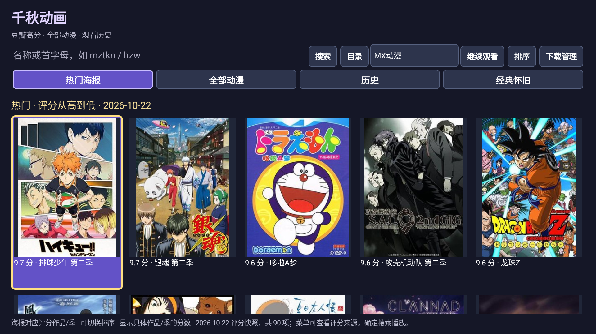
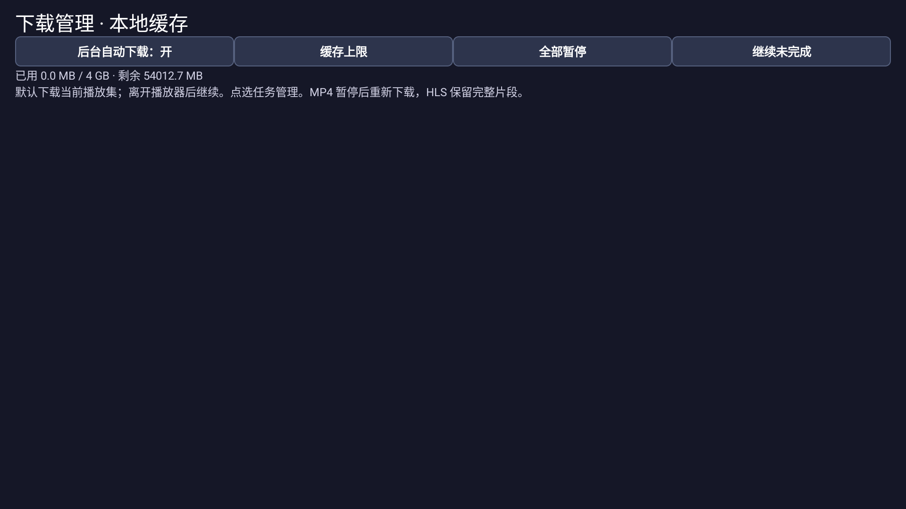

# 千秋动画

> **学习用途与免责声明：下载、安装或使用前请先阅读。**
>
> 本项目用于 Android 电视应用开发、网络播放、遥控器适配与音视频解码的学习和技术交流。本项目不托管影视或广播视频；代码开源、地址公开或检测通过，不代表已取得相关内容的传播授权。请仅访问自己有权使用的内容，遵守适用法律、来源服务条款及第三方许可，不得用于侵犯版权或其他权益的用途。
>
> 第三方网页、播放地址及评分数据可能变化；不保证全部内容可播放、长期可用或兼容所有电视。安装、网络调试和自行配置应由设备所有者了解后操作。本声明不免除任何依法应承担的责任。如发现权利或安全问题，请通过本仓库 Issues 提供具体链接和说明，以便核查处理。

适合遥控器操作的 Android 动漫目录与播放器。当前发布 **1.4.0**，包名 `com.qianq.kandongman`。最低声明为 Android 5.0；本轮新增功能在 **AM9 PRO / Android 14** 验证，未在 Android 5 真机复验。

[下载 APK 与完整源码](https://github.com/suqianqiu/qianqiu-animation/releases/latest) · [安装指南](INSTALL.md) · [验证记录](VERIFICATION.txt) · [第三方说明](THIRD_PARTY.txt)

## 1.4.0 新增功能

- **完整竖版海报**：热门90项使用对应评分作品/季的海报，按原图比例完整显示。评分为2026-10-22快照，非实时热度榜。
- **译名合并与经典目录**：美食猎人/美食的俘虏、百变小樱魔术卡/魔卡少女樱合并为同一目录入口，其他已收录别名继续支持检索。续作、重制版仍独立保留。新增35项，共464项目录。
- **经典怀旧**：正气大侠、天空战记、宇宙骑士等。正气大侠可用“猜拳超人”、Jankenman、日文名或 `zqdx` 搜索。收录目录不等于来源有可播放视频，正气大侠尚未验证播放成功。
- **排序与国语标记**：热门按评分或名称排序，目录支持A–Z/Z–A。根据来源明确标出的国语、普通话、中文配音等信息优先排序；中文字幕不当成国语。未执行声音识别，无信息时显示“语言未标注”。
- **各级下载按钮**：作品搜索结果、线路、分集列表右侧均有下载按钮。作品层先选择线路，线路层可下载全部剧集，分集层可下载单集。同来源相同剧集URL不重复建任务。
- **缓存与文件管理**：默认后台下载当前集，HLS片段落盘复用。支持进度、速度、暂停、继续、重试、已下载筛选、文件信息、作品/集数排序、单集删除和批量清理已下载。

## 新版界面与历史实测截图

以下是实际设备截图，未用设计稿替代。新版与历史版本分别标明；不公开个人观看历史、头像或设备地址。

**1.4.0 热门首页：对应作品的完整竖版海报、评分、排序及经典怀旧入口。**



**缓存管理的基础界面（1.3.0历史截图，无观看条目）：后台下载开关、容量上限、全部暂停和继续。1.4.0在此基础上增加“全部任务/未完成/已下载文件”筛选、排序和批量清理。**



**历史播放实测（1.2.0）：播放器已显示视频与进度。这是此前验证画面，不代表1.4.0对所有来源重新验证。**


## 下载、安装与遥控器操作

[1.4.0 APK](https://github.com/suqianqiu/qianqiu-animation/releases/download/v1.4.0/QianqiuAnimation-1.4.0.apk) · [完整源码 ZIP](https://github.com/suqianqiu/qianqiu-animation/releases/download/v1.4.0/QianqiuAnimation-1.4.0-source.zip) · [SHA-256 校验](https://github.com/suqianqiu/qianqiu-animation/releases/download/v1.4.0/SHA256SUMS.txt)

APK包含32位ARM库，支持运行32位应用的ARM设备；不包含x86或ARM64原生库。安装步骤、U盘方法、网络ADB与可复制给电脑AI的安装提示词见[安装指南](INSTALL.md)。需要设备允许安装外部APK；无需电脑服务常驻。

- 方向键移动，默认确定进入下一级或播放。
- 有下载按钮的列表：**右键选下载 → 确定**；左键返回名称。作品层下载先选线路，再确认数量。
- 播放中确定/菜单打开控制栏；收起后左右键快退/快进10秒；返回保存进度。
- 下载管理可查看“已下载文件”并离线播放；删除会清除对应本地文件，请先退出该集播放。

## 缓存规则与已知限制

默认4GB缓存上限，可选1/4/8/16GB；至少保留512MB系统可用空间。不会自动删除已下载内容。HLS暂停后保留完整片段，未完成片段重下；MP4暂停后整文件重下，完整下载后可离线播放。默认自动下载当前集，批量下载需通过相应列表按钮确认。

支持普通HLS点播、AES-128密钥和初始化片段；直播、字节范围HLS、独立外部音轨及其他加密格式暂不支持缓存。无法纯后台解析的网页线路会提示先进入播放页面解析，再重试下载。应用被强行停止或盒子重启后，可到下载管理继续任务。

慢源、网络带宽、临时签名和网页变动仍可能导致等待或失败。可先缓存一段或整集下载后再看；不能承诺所有来源无卡顿。无账号登录、付费鉴权或DRM绕过功能。

## 验证

本版在AM9 PRO / Android 14完成19项设备检查：HLS重写、缓存复用、暂停、后台下载、范围请求、未进入播放器时解析入队、任务去重、离线出画面、恢复与容量限制、文件筛选/删除、遥控器右键选择下载。目录与语言测试还检查译名合并、续作/重制版保留、首字母检索及国语优先。记录见[VERIFICATION.txt](VERIFICATION.txt)。

90张海报均已核对文件存在，并在盒子检查竖版显示；图片与评分来源见[海报来源清单](verification/poster-sources.json)。语言标签来自来源声明，不能代替实际音轨验证。

历史2026-10-22目录审计仍保存在 `verification/catalog-audit/`，对应当时431个名称，不是本版464项全部可播放的证明。HTTP 200/206也不能等同于完整播放验证。

## 从源码构建

Windows、PowerShell 7、JDK 21、Android SDK `platforms;android-35` 和 `build-tools;35.0.0`。SDK默认目录为 `%LOCALAPPDATA%/Android/Sdk`。

```powershell
pwsh -File tools/fetch-deps.ps1
pwsh -File build.ps1
```

输出 `dist/KanDongman-1.4.0.apk`。依赖从Maven Central获取并核对SHA-256；完整源码ZIP包含原始AAR、库源码和依赖。构建会创建自己的本地签名文件，发布者私钥不随源码提供；不同签名不能覆盖安装发布版。

## 来源与许可

Java源码使用[MIT](LICENSE)。VideoLAN LibVLC 3.6.5使用LGPL-2.1-or-later，jsoup 1.13.1使用MIT，原始规则来自[KazumiRules](https://github.com/Predidit/KazumiRules)（MIT）。完整许可、原生库源码信息见[THIRD_PARTY.txt](THIRD_PARTY.txt)和 `licenses/`。

海报、评分、作品名称及影视内容权利归各自权利人；海报是公开元数据的界面展示素材，不纳入本项目MIT授权范围。源码开源、学习用途说明及免责声明均不代表取得内容传播授权，也不免除依法应承担的责任。发现权利或安全问题请通过Issues提供具体信息以便核查处理。
