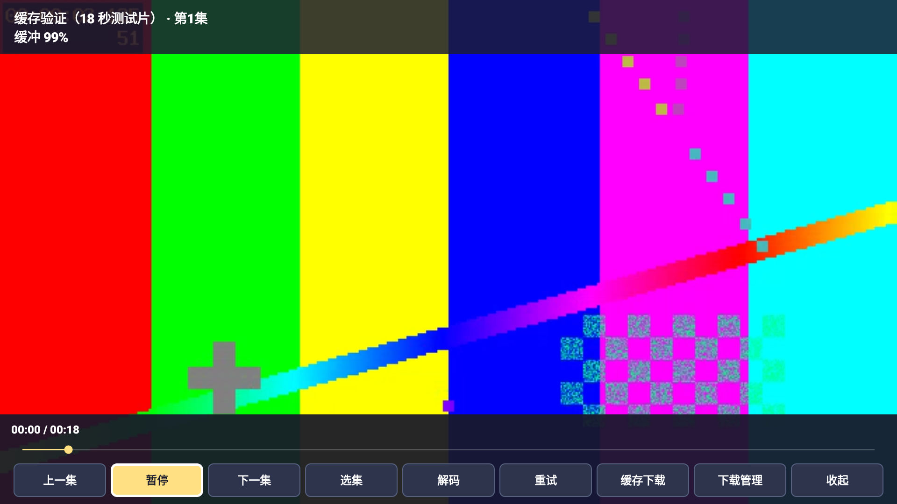

# 千秋动画

> **学习用途与免责声明：下载、安装或使用前请先阅读。**
>
> 本项目用于 Android 电视应用开发、网络播放、遥控器适配与音视频解码的学习和技术交流。本项目不托管影视或广播视频；代码开源、地址公开或检测通过，不代表已取得相关内容的传播授权。请仅访问自己有权使用的内容，遵守适用法律、来源服务条款及第三方许可，不得用于侵犯版权或其他权益的用途。
>
> 第三方网页、播放地址及评分数据可能变化；不保证全部内容可播放、长期可用或兼容所有电视。安装、网络调试和自行配置应由设备所有者了解后操作。本声明不免除任何依法应承担的责任。如发现权利或安全问题，请通过本仓库 Issues 提供具体链接和说明，以便核查处理。

适合遥控器操作的 Android 动漫目录与播放器。当前发布 **1.5.0**，包名 `com.qianq.kandongman`。最低声明为 Android 5.0；本轮新增功能在 **AM9 PRO / Android 14** 验证，未在 Android 5 真机复验。

[下载 APK 与完整源码](https://github.com/suqianqiu/qianqiu-animation/releases/latest) · [安装指南](INSTALL.md) · [验证记录](VERIFICATION.txt) · [第三方说明](THIRD_PARTY.txt)

## 1.5.0 更新：播放防劫持与手动下载

- **播放防劫持**：不再把网页最先请求的视频当作正片，改为识别明确的播放器配置或稳定的视频元素；拦截已知广告地址、网页弹窗、外部应用唤起及顶层页面替换。验证重定向后的播放地址，检查初始HLS清单中的可识别广告资源；进入原生播放器前销毁解析网页。
- **播放不默认下载**：普通播放只使用播放器内存缓冲，不创建磁盘缓存任务、不因播放启动后台下载服务。只有点击播放页“缓存下载”、列表下载按钮并确认，或在下载管理主动继续任务后，才执行后台下载。
- **旧任务迁移**：升级前的未完成任务默认暂停，避免旧版自动下载继续运行；已下载文件保留。需要时可在下载管理主动继续。

### 与 1.2.0 对比

| 项目 | 1.2.0 | 1.5.0 |
| --- | --- | --- |
| 播放地址识别与防护 | 基础网页解析与原生播放 | 明确播放器配置优先，限制广告请求、弹窗和页面替换，解析后关闭网页 |
| 下载方式 | 无持久后台缓存与下载管理 | 仅手动触发后台下载；普通播放不自动下载 |
| 缓存与文件管理 | 无 | HLS片段复用、MP4下载、进度/速度、暂停/继续/重试、离线播放、文件筛选/排序/删除与批量清理 |
| 列表下载 | 无 | 作品、线路、分集右侧下载；作品先选线路，线路可下载整条，分集下载单集 |
| 热门海报 | 旧版目录展示 | 热门90项对应作品/季的完整竖版海报，按比例完整显示 |
| 目录与译名 | 旧版目录 | 464项，补充35项经典、合并2组重复译名；续作/重制版保留独立入口 |
| 排序和国语 | 基础列表 | 评分/名称排序、目录A–Z/Z–A；来源明确声明的国语优先，无信息显示“语言未标注” |

正气大侠支持“猜拳超人”、Jankenman、日文名或 `zqdx` 搜索；目录收录不代表来源有可播放视频，该作品尚未验证播放成功。语言标记来自来源声明，未执行声音识别。热门评分为2026-10-22快照，非实时热度榜。

## 新版界面与历史实测截图

以下是实际设备截图，未用设计稿替代。新版与历史版本分别标明；不公开个人观看历史、头像或设备地址。

**沿用的1.4.0热门首页：对应作品的完整竖版海报、评分、排序及经典怀旧入口。**


**1.5.0 播放页：新增“缓存下载”按钮。画面为自生成18秒测试片，无私人观看记录；普通播放不会自动下载。**



## 下载、安装与遥控器操作

[1.5.0 APK](https://github.com/suqianqiu/qianqiu-animation/releases/download/v1.5.0/QianqiuAnimation-1.5.0.apk) · [完整源码 ZIP](https://github.com/suqianqiu/qianqiu-animation/releases/download/v1.5.0/QianqiuAnimation-1.5.0-source.zip) · [SHA-256 校验](https://github.com/suqianqiu/qianqiu-animation/releases/download/v1.5.0/SHA256SUMS.txt)

APK包含32位ARM库，支持运行32位应用的ARM设备；不包含x86或ARM64原生库。安装步骤、U盘方法、网络ADB与可复制给电脑AI的安装提示词见[安装指南](INSTALL.md)。需要设备允许安装外部APK；无需电脑服务常驻。

- 方向键移动，默认确定进入下一级或播放。
- 有下载按钮的列表：**右键选下载 → 确定**；左键返回名称。作品层下载先选线路，再确认数量。
- 播放中确定/菜单打开控制栏；收起后左右键快退/快进10秒；返回保存进度。
- 播放页点击“缓存下载”才加入后台任务；列表下载仍需确认。
- 下载管理可查看“已下载文件”并离线播放；删除会清除对应本地文件，请先退出该集播放。

## 缓存规则与已知限制

默认4GB缓存上限，可选1/4/8/16GB；至少保留512MB系统可用空间。不会自动删除已下载内容。HLS暂停后保留完整片段，未完成片段重下；MP4暂停后整文件重下，完整下载后可离线播放。普通播放不自动下载；手动确认的下载任务可在退出播放后继续。升级前的未完成旧任务暂停，需手动继续。

支持普通HLS点播、AES-128密钥和初始化片段；直播、字节范围HLS、独立外部音轨及其他加密格式暂不支持缓存。无法纯后台解析的网页线路会提示先进入播放页面解析，再重试下载。应用被强行停止或盒子重启后，可到下载管理继续任务。

广告防护基于可识别的地址和网页行为，不能保证移除视频内嵌、混淆或与正片共用地址的广告；原生播放器后续获取的动态子清单不经过网页拦截。不会自动裁剪片段或修改加密时间线。严格限制跳转可能使部分跨域iframe或复杂JavaScript线路无法解析，请换线路。

慢源、网络带宽、临时签名和网页变动仍可能导致等待或失败。可先缓存一段或整集下载后再看；不能承诺所有来源无卡顿。无账号登录、付费鉴权或DRM绕过功能。

## 验证

本版在AM9 PRO / Android 14完成26项设备检查，包括普通播放不建任务/不启动下载服务、旧自动下载偏好无效、手动下载完成，以及“广告先请求、弹窗、顶层跳转”的模拟网页防护；同时复验HLS缓存、离线解码、范围请求、后台队列、文件管理与遥控器下载操作。另有9项URL/清单防护检查、三个来源的离线HTML解析回归及任意脚本视频地址拒绝测试。这些结果不代表全部来源或所有广告类型均已验证。记录见[VERIFICATION.txt](VERIFICATION.txt)。

90张海报均已核对文件存在，并在盒子检查竖版显示；图片与评分来源见[海报来源清单](verification/poster-sources.json)。语言标签来自来源声明，不能代替实际音轨验证。

历史2026-10-22目录审计仍保存在 `verification/catalog-audit/`，对应当时431个名称，不是本版464项全部可播放的证明。HTTP 200/206也不能等同于完整播放验证。

## 从源码构建

Windows、PowerShell 7、JDK 21、Android SDK `platforms;android-35` 和 `build-tools;35.0.0`。SDK默认目录为 `%LOCALAPPDATA%/Android/Sdk`。

```powershell
pwsh -File tools/fetch-deps.ps1
pwsh -File build.ps1
```

输出 `dist/KanDongman-1.5.0.apk`。依赖从Maven Central获取并核对SHA-256；完整源码ZIP包含原始AAR、库源码和依赖。构建会创建自己的本地签名文件，发布者私钥不随源码提供；不同签名不能覆盖安装发布版。

## 来源与许可

Java源码使用[MIT](LICENSE)。VideoLAN LibVLC 3.6.5使用LGPL-2.1-or-later，jsoup 1.13.1使用MIT，原始规则来自[KazumiRules](https://github.com/Predidit/KazumiRules)（MIT）。完整许可、原生库源码信息见[THIRD_PARTY.txt](THIRD_PARTY.txt)和 `licenses/`。

海报、评分、作品名称及影视内容权利归各自权利人；海报是公开元数据的界面展示素材，不纳入本项目MIT授权范围。源码开源、学习用途说明及免责声明均不代表取得内容传播授权，也不免除依法应承担的责任。发现权利或安全问题请通过Issues提供具体信息以便核查处理。
