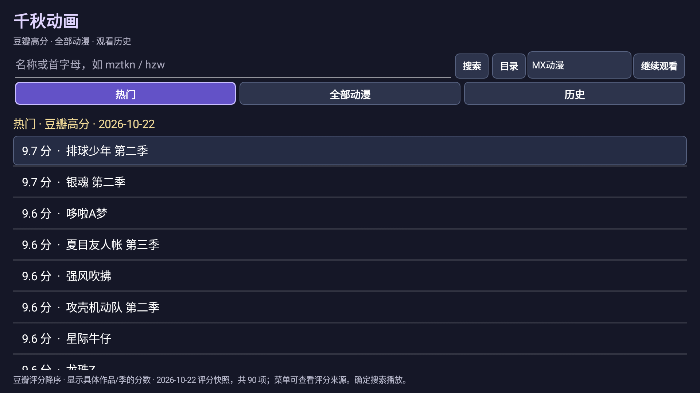
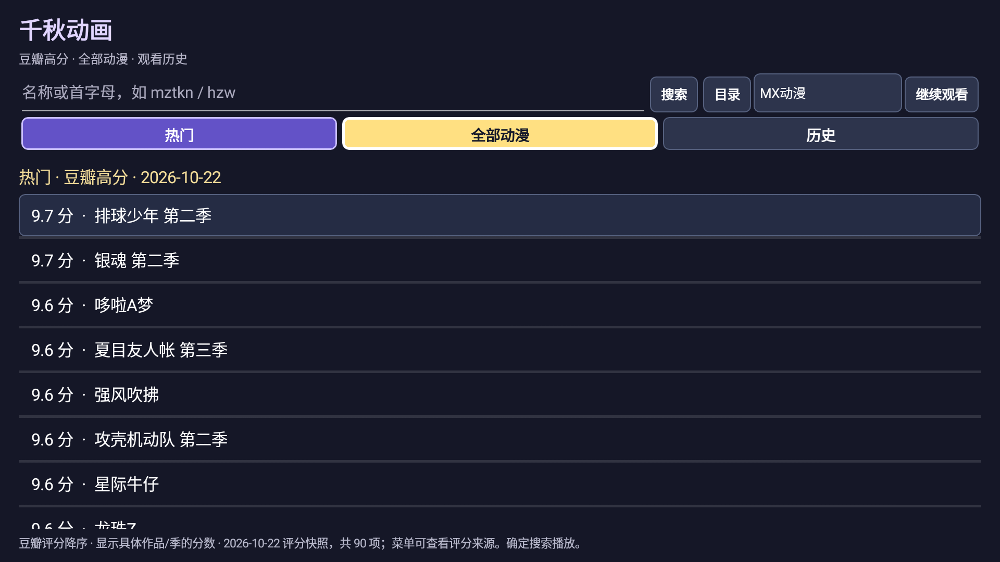
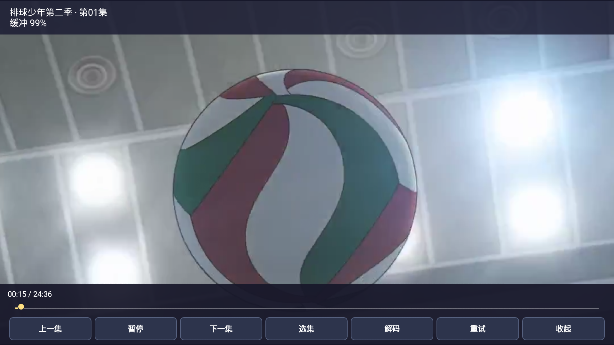

# 千秋动画

> **学习用途与免责声明：下载、安装或使用前请先阅读。**
>
> 本项目用于 Android 电视应用开发、网络播放、遥控器适配与音视频解码的学习和技术交流。本项目不托管影视或广播视频；代码开源、地址公开或检测通过，不代表已取得相关内容的传播授权。请仅访问自己有权使用的内容，遵守适用法律、来源服务条款及第三方许可，不得用于侵犯版权或其他权益的用途。
>
> 第三方网页、播放地址及评分数据可能变化；不保证全部内容可播放、长期可用或兼容所有电视。安装、网络调试和自行配置应由设备所有者了解后操作。本声明不免除任何依法应承担的责任。如发现权利或安全问题，请通过本仓库 Issues 提供具体链接和说明，以便核查处理。

适合遥控器操作的 Android 电视动漫目录、搜索和播放器。当前版本 **1.2.0**，最低 Android 5.0 / API 21，安装包包含 **armeabi-v7a（32 位 ARM）**。

[下载 APK 和完整源码](https://github.com/suqianqiu/qianqiu-animation/releases/latest) · [版本验证记录](VERIFICATION.txt) · [第三方说明](THIRD_PARTY.txt)

## 下载与安装

在 Releases 下载 `QianqiuAnimation-1.2.0.apk`，通过电视文件管理器安装；使用 USB 或电视自己的安装方式即可，不需要电脑服务常驻。`SHA256SUMS.txt` 可用于校验文件。

[直接下载 1.2.0 APK](https://github.com/suqianqiu/qianqiu-animation/releases/download/v1.2.0/QianqiuAnimation-1.2.0.apk) · [完整源码 ZIP](https://github.com/suqianqiu/qianqiu-animation/releases/download/v1.2.0/QianqiuAnimation-1.2.0-source.zip)

包名 `com.qianq.kandongman`。实测设备为微鲸 WTV55K1J，Android 5.0.2、2 GB 内存。其他 Android TV、盒子或新版 Android 的安装、遥控器和播放兼容性未逐一验证；本包不含 x86 或 ARM64 原生库，不能承诺在仅支持 64 位应用的设备上运行。

## 电脑 AI 工具联网安装 / U 盘安装

**电脑 AI 安装：**在电脑上的 Codex、WorkBuddy 等具备本机终端与局域网访问能力的 AI 工具中，提供本项目地址、APK 下载链接和自己电视的 ADB 地址。工具可协助下载并校验 APK、通过同一局域网连接已授权的电视、执行覆盖安装并启动验证。电视端需先开启厂商支持的 ADB / 网络调试并确认授权；普通网页聊天不能直接替电脑安装。

**U 盘安装：**下载 `QianqiuAnimation-1.2.0.apk` → 复制到电视能识别的 U 盘 → 插入电视 → 在文件管理器中打开 APK → 按系统提示允许该安装来源 → 完成安装并从应用列表打开。U 盘只负责传输安装包，在线观看仍需要电视联网。

完整步骤、可复制给 AI 的提示词、ADB 命令、无线配对说明和常见问题见 **[安装指南 INSTALL.md](INSTALL.md)**。电视不支持 ADB 时可优先尝试 U 盘；两种方式都依赖电视系统允许安装外部应用。

## 功能

- 首页包含 **热门、全部动漫、历史**，默认进入热门。
- 热门为与目录匹配的 **90 部豆瓣高分作品**，按评分排序，显示实际作品或季名。数据快照日期 **2026-10-22**，并非实时热度榜或完整豆瓣排名。
- 基础目录 431 个名称，检查后默认可见 428 个。支持 A–Z / # 筛选、中文和别名查询，以及每个汉字的拼音首字母检索，例如 `mztkn`、`hzw`；大小写、空格和全角字母会归一化。
- 公开网页来源可切换，支持搜索、线路、分集、续播、进度拖动，以及自动 / 硬解 / 软解。
- 最近 20 部观看历史保存在电视本机；记录剧集和进度。
- 焦点按钮为亮黄色、深色文字和白边，当前激活标签为紫色，方便用遥控器辨认。

## 真实电视运行画面

以下均为此前调试时直接从电视截取的原始画面，不是设计稿。截图中的内容来自当时选择的来源，仅证明该次操作或该条线路成功，不代表所有作品、剧集和线路都可播放。

**1.2.0 首页：热门、全部动漫、历史及带日期的评分。**



**遥控器焦点：亮黄色为当前焦点，紫色为当前激活标签。**



**实际播放成功：《排球少年 第二季》第 1 集，播放器已显示视频画面和进度。**



## 遥控器操作

方向键移动焦点，确定键选择；进入作品后依次选择搜索结果、播放线路和分集。播放中按确定或菜单显示控制栏，控制栏收起时左右键快退 / 快进 10 秒。返回键回到分集页面并保存进度。未收录作品也可输入完整名称搜索来源。

## 检查结果与边界

2026-10-22 在电脑端检查 431 个目录名称、3 个来源，共记录 **4,182 次 HTTP 检查**。428 个名称至少有一个来源的搜索、详情与抽查分集页面通过；411 个名称至少有一个抽查媒体入口返回 HTTP 200 / 206。3 个全来源无搜索结果的名称被默认隐藏，16 个名称通过别名修正找回。见 [检查摘要](verification/catalog-audit/summary.json)。

本轮没有确认需清除的 404 / 410 地址。应用只有在重复确认 404 / 410 后才过滤链接；401 / 403、超时及临时服务器错误不会直接视为永久失效。健康快照有效期为 7 天。

HTTP 200 / 206 仅表示入口可访问，不能等同于完整播放验证；未逐集、逐线路或逐个 HLS 分片验证。网页结构、CDN、地区和网络条件变化可能导致播放失败。自动解码发生错误或 25 秒无视频时仅尝试一次软解，软解不能修复网络错误。

## 从源码构建

环境：Windows、PowerShell 7、JDK 21、Android SDK `platforms;android-35` 和 `build-tools;35.0.0`。SDK 默认目录为 `%LOCALAPPDATA%/Android/Sdk`，`javac`、`jar` 和 `keytool` 需在 PATH 中。

```powershell
pwsh -File tools/fetch-deps.ps1
pwsh -File build.ps1
```

输出为 `dist/KanDongman-1.2.0.apk`。Git 仓库不存放大型依赖，下载脚本从 Maven Central 获取固定版本并核对 SHA-256。Releases 的 `*-source.zip` 另含原始 AAR、Java 源码包和构建依赖，便于保存完整构建材料。

构建脚本首次执行会生成自己的本地签名文件；发布者的签名私钥不在仓库或源码包中。自行构建的不同签名 APK 无法覆盖已安装的发布版，需要使用自己的签名持续更新，或先卸载原版（卸载会清除本地历史）。

目录检查脚本需要 Python 3、`requests`、`lxml`；运行 `verification/audit_catalog.py`，再运行 `verification/finalize_catalog_audit.py`。检查会访问来源网站，完整流程可能较慢。单元测试和固定网页样本在 `tests/`，历史验证说明在 `VERIFICATION.txt`。豆瓣快照来源记录在 `verification/douban/`。

## 来源与许可

应用 Java 源码使用 [MIT](LICENSE)。播放器使用 VideoLAN LibVLC 3.6.5（LGPL-2.1-or-later），HTML 解析使用 jsoup 1.13.1（MIT）；三个原始网页规则来自 [KazumiRules](https://github.com/Predidit/KazumiRules)（MIT）。本项目独立实现 Java 解析与播放逻辑。公开 CA 根证书用于补充老 Android 的信任库，证书链和主机名验证仍然启用。

本项目不托管影视文件，网页规则、目录、评分和视频内容的权利分别属于各自权利人。开源代码许可不代表获得视频传播授权；请根据所在地区和来源授权情况使用。完整第三方来源、版本及原生库源码信息见 [THIRD_PARTY.txt](THIRD_PARTY.txt) 和 `licenses/`。
